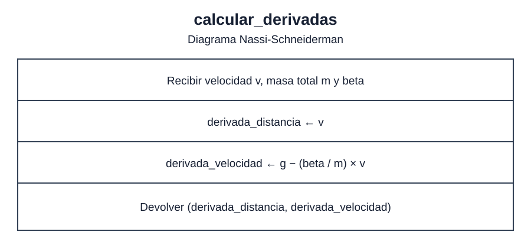

# Diagramas Nassi-Schneiderman

Los diagramas representan el diseño común de las versiones
en C, Pascal y Fortran.

## Programa principal

`main` establece la configuración, solicita los datos,
coordina su validación y ejecuta la búsqueda de resistencia.

Si la búsqueda tiene éxito, muestra los resultados.
En caso contrario, informa el motivo del error.

El diagrama representa el programa completo previsto.
La primera implementación en C probará inicialmente
la simulación con una resistencia fija.

## Cálculo de derivadas

Evalúa las tasas de cambio de distancia y velocidad
para una velocidad, masa y resistencia dadas.
No modifica el estado ni avanza el tiempo.

## Paso de Runge-Kutta de cuarto orden

Calcula cuatro evaluaciones de las derivadas y las combina
para obtener la distancia y velocidad siguientes.

Los valores originales se conservan durante todas las
evaluaciones. Los valores k representan pendientes
y no incluyen el factor h.

## Diagramas pendientes

- Lectura y validación de datos.
- Simulación de la caída.
- Refinamiento del impacto.
- Búsqueda de beta.
- Presentación de resultados.