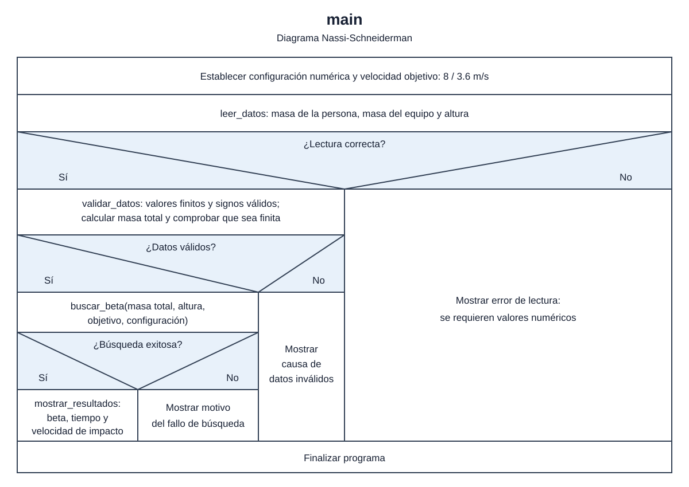
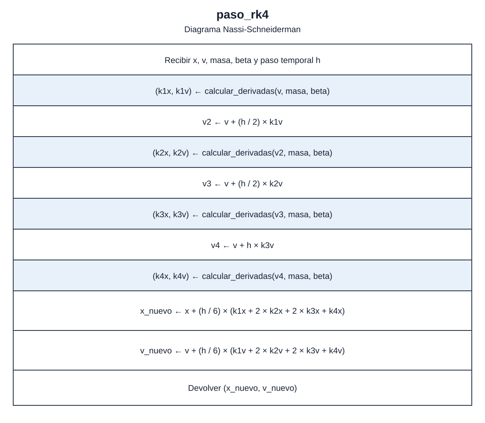
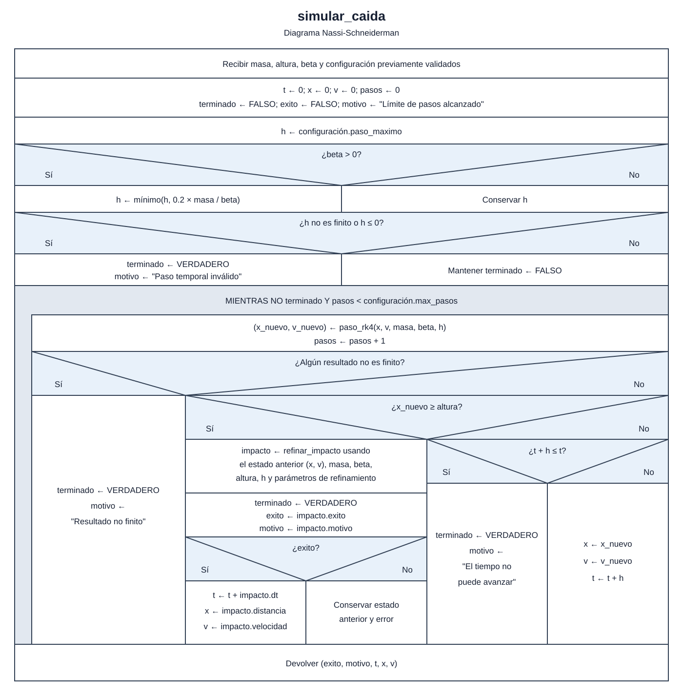
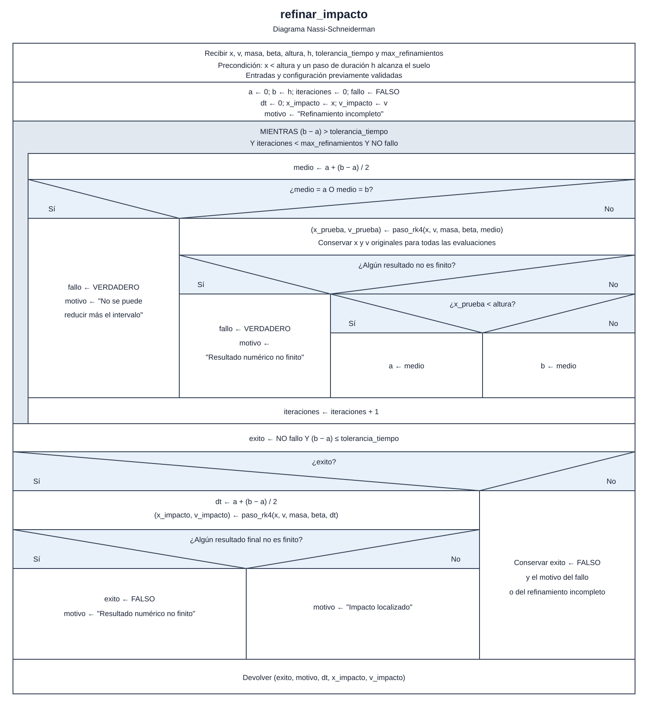
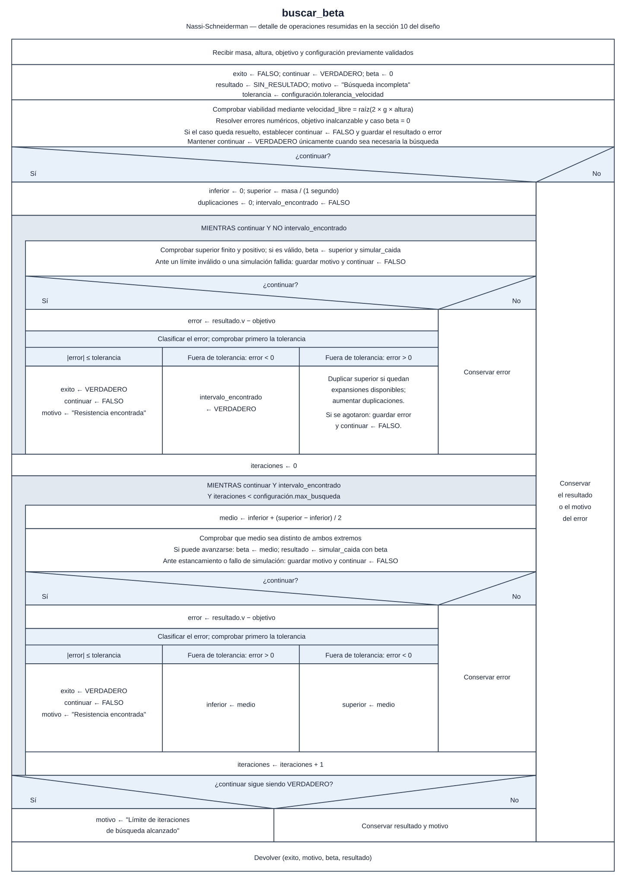
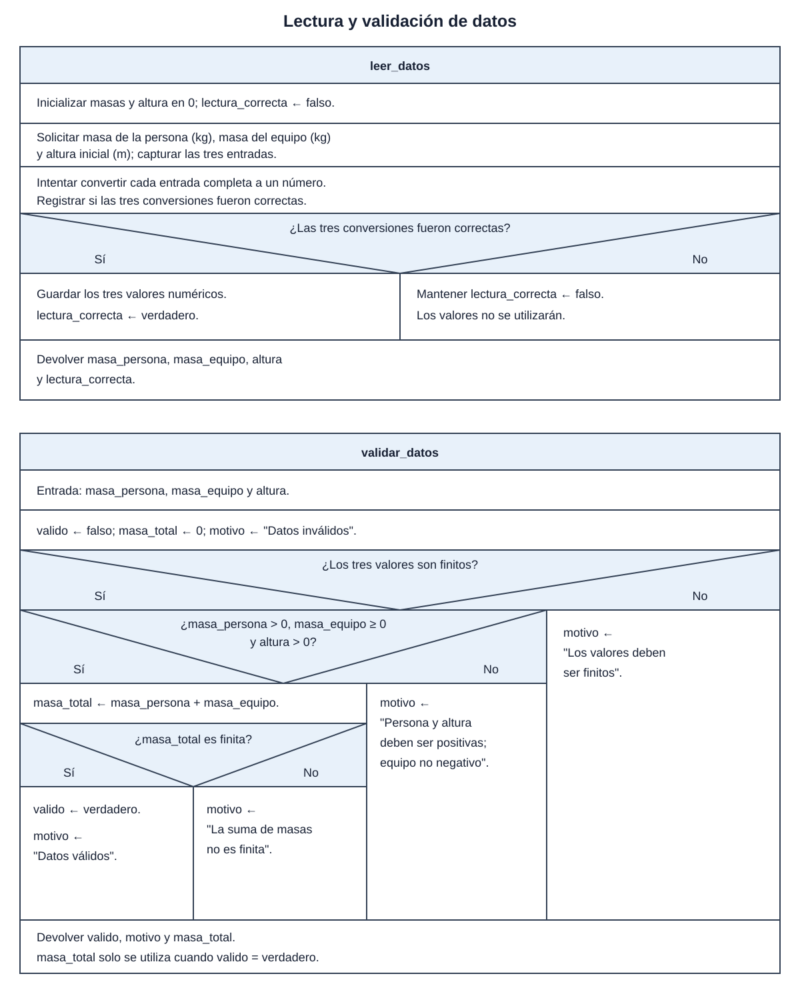
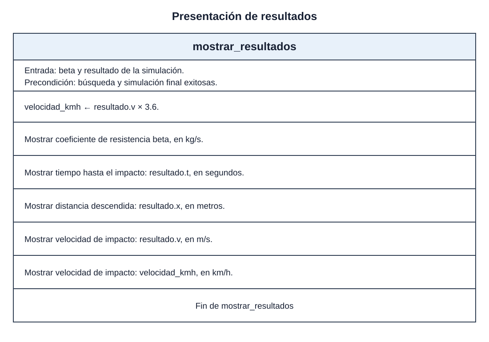

# Diagramas Nassi-Schneiderman

Los diagramas representan el diseño común de las versiones
en C, Pascal y Fortran.

## Programa principal

`main` establece la configuración, solicita los datos,
coordina su validación y ejecuta la búsqueda de resistencia.

Si la búsqueda tiene éxito, muestra los resultados.
En caso contrario, informa el motivo del error.

El diagrama representa el programa completo previsto.
La primera implementación en C probará inicialmente
la simulación con una resistencia fija.

## Cálculo de derivadas

Evalúa las tasas de cambio de distancia y velocidad
para una velocidad, masa y resistencia dadas.
No modifica el estado ni avanza el tiempo.

## Paso de Runge-Kutta de cuarto orden

Calcula cuatro evaluaciones de las derivadas y las combina
para obtener la distancia y velocidad siguientes.

Los valores originales se conservan durante todas las
evaluaciones. Los valores k representan pendientes
y no incluyen el factor h.

## Simulación de la caída

Inicializa el estado, selecciona el paso temporal y repite
RK4 hasta detectar el suelo, un error o el límite de pasos.

Cuando un paso alcanza o supera la altura, utiliza
`refinar_impacto` desde el último estado anterior al suelo.

El resultado solo representa una llegada válida cuando
el indicador de éxito es verdadero.

## Refinamiento del impacto

Localiza el impacto mediante bisección dentro del último
intervalo temporal de la simulación.

Cada evaluación RK4 parte del mismo estado anterior
al suelo. La función devuelve el tiempo adicional,
la distancia y la velocidad aproximadas del impacto.

El resultado solo es válido cuando el indicador de éxito
es verdadero.

## Búsqueda de resistencia

Comprueba la viabilidad del objetivo, construye un intervalo
que encierra la solución y aplica bisección para encontrar beta.

Cada candidato se evalúa mediante una simulación completa
desde el reposo.

El diagrama resume algunas operaciones de comprobación.
Su lógica detallada aparece en la sección 10 de
`../diseno-algoritmo.md`.

El resultado solo se considera válido cuando el indicador
de éxito es verdadero.

## Lectura y validación de datos

Incluye dos funciones separadas:

- `leer_datos`: solicita las entradas y comprueba su conversión
  a valores numéricos.
- `validar_datos`: verifica valores finitos, restricciones de
  masa y altura, y calcula la masa total.

La masa total solo se utiliza cuando la validación es exitosa.

## Presentación de resultados

Muestra el coeficiente de resistencia, el tiempo de caída,
la distancia descendida y la velocidad de impacto.

La velocidad se presenta en m/s y km/h.

Esta función se ejecuta únicamente cuando la búsqueda
y la simulación final han sido exitosas.

## Cobertura de diagramas — v0.3

- [x] Flujo principal (`main`).
- [x] Cálculo de derivadas.
- [x] Paso de integración RK4.
- [x] Simulación de la caída.
- [x] Refinamiento del impacto.
- [x] Búsqueda de beta.
- [x] Lectura y validación de datos.
- [x] Presentación de resultados.

Los diagramas describen el diseño común para las
implementaciones en C, Pascal y Fortran.